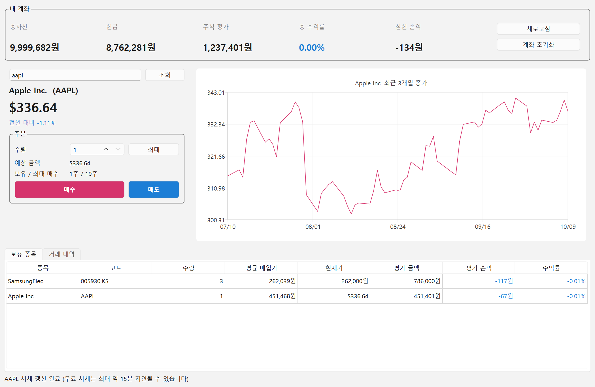

# 모의투자 (Mock Trading)

실제 주식 시세(한국 · 미국)를 받아 와서, **가상의 기초 자금**으로 실제처럼 매수·매도를 연습하는 데스크톱 프로그램입니다.



## 주요 기능

- **기초 자금 받기**: 처음 실행하면 연습에 쓸 가상 자금(원)을 정합니다. 언제든 초기화하고 다시 시작할 수 있습니다.
- **실제 시세 조회**: 한국 주식은 6자리 코드(`005930`), 미국 주식은 티커(`AAPL`)로 조회합니다. 코스피/코스닥은 자동으로 구분합니다.
- **매수·매도**: 현재가로 체결됩니다. 수수료(0.015%)와 국내 주식 매도 거래세(0.20% 가정)를 반영합니다.
- **미국 주식 환율 적용**: 원화 계좌에서 미국 주식을 사고팔 때 그 시점의 원/달러 환율로 환산합니다. 환차손익도 손익에 들어갑니다.
- **계좌 현황**: 총자산, 현금, 주식 평가액, 총 수익률, 실현 손익을 보여줍니다.
- **보유 종목 · 거래 내역**: 이동평균 매입가와 평가 손익, 전체 체결 기록을 보여줍니다.
- **3개월 종가 차트**: 조회한 종목의 최근 흐름을 보여줍니다.
- 60초마다 자동으로 갱신합니다.

## 실행 방법

Python 3.11 이상이 필요합니다.

```bash
python -m venv .venv
.venv\Scripts\activate          # macOS/Linux: source .venv/bin/activate
pip install -r requirements.txt
python -m mock_trading
```

거래 기록은 `~/.mock_trading/mock_trading.db`(SQLite)에 저장됩니다.

## 테스트

```bash
python -m pytest
```

시세는 가짜 provider로 대신하므로 네트워크 없이 돌아갑니다.

## 구조

```
mock_trading/
├── domain.py        # 금액 규칙(Decimal), 시세·거래·보유 모델
├── market_data.py   # 시세 조회 인터페이스 + yfinance 구현
├── storage.py       # SQLite 거래 장부, 장부에서 현금·보유·실현손익 계산
├── broker.py        # 주문 검증과 체결, 수수료, 계좌 평가
├── __main__.py      # 실행 진입점
└── ui/
    ├── main_window.py  # PySide6 화면
    ├── worker.py       # 백그라운드 작업 스레드
    └── format.py       # 금액·수익률 표시 형식
tests/               # pytest
```

화면(`ui/`)은 입력을 넘기기만 하고, 검증과 계산은 모두 `broker.py`에서 합니다. 그래서 핵심 로직을 화면 없이 테스트할 수 있습니다.

## 설계에서 신경 쓴 점

| 문제 | 결정 |
|---|---|
| float 오차로 잔고가 1원씩 어긋남 | 금액은 전부 `Decimal`. 원화는 1원 단위, 수수료는 버림 |
| 현금과 보유 수량이 서로 어긋날 수 있음 | **추가만 하는 거래 장부**만 저장하고, 현금·보유·실현 손익은 장부에서 계산 |
| 잔고 확인과 기록 사이에 다른 주문이 끼어듦 | 확인과 기록을 한 트랜잭션(`BEGIN IMMEDIATE`)에서 처리 |
| 외부 시세가 NaN·Infinity·0일 수 있음 | 유한한 양수만 받고, 체결 직전 다시 검사, 장부에 기록하기 전에 한 번 더 검사 |
| 달러 가격을 센트로 반올림하면 0원 체결이나 반올림 차익이 생김 | 달러 가격은 0.0001 단위로 시세를 받을 때 한 번만 정규화하고, 체결과 평가에 같은 가격 사용 |
| 데이터 오류로 시세·환율이 튐 | 전일 종가 대비 범위(원화 0.65~1.35배, 달러 1/3~3배)와 환율 범위(500~3000원) 밖이면 주문 차단 |
| 확인창을 본 뒤 가격·환율이 바뀜 | 확인창에서 본 가격·환율과 5% 넘게 다르면 체결 거부 |
| 시세를 기다리는 사이 계좌 초기화 | 계좌 세대 값을 주문 시작과 기록 직전에 비교해 다르면 취소 |
| 외부 종목명에 HTML이 섞일 수 있음 | 제어문자 제거, 길이 제한, 화면에는 일반 텍스트로만 표시 |
| 네트워크 호출로 화면이 멈춤 | 작업 스레드 하나에서 실행하고, Repository의 RLock으로 DB 접근을 직렬화 |
| SQL 인젝션 | 모든 쿼리에 파라미터 바인딩 |

## 한계

- yfinance 무료 시세는 **최대 약 15분 지연**될 수 있습니다. 실시간 체결과 다릅니다.
- 장 운영 시간과 호가 단위, 상·하한가는 고려하지 않고 현재가로 바로 체결합니다.
- 수수료와 세금은 단순화한 값입니다. ETF 거래세 면제, 해외 주식 양도세 등은 반영하지 않습니다.
- 지원 통화는 원(KRW)과 달러(USD)입니다.
- 현재가와 전일 종가를 같은 출처(yfinance)에서 받으므로, 두 값이 함께 잘못 오면 이상 시세 검사를 통과할 수 있습니다.
- 전일 종가를 받지 못하면 시세가 정상인지 판단할 수 없어 매수·매도를 모두 막습니다.

## 브랜치 전략

- `main`: 큰 틀이 완성된 안정 버전
- `develop`: 개발 통합 브랜치
- `feature/*`: 기능별 작업. 완료되면 `develop`으로 PR

## 개발 방식

세 개의 Claude Code 세션으로 역할을 나눠 개발했습니다.

- **Code**: 기능 구현, 리뷰 반영
- **QA**: 버그 탐지와 테스트 누락 확인 (코드를 직접 수정하지 않음)
- **Security**: 보안 리뷰 (코드를 직접 수정하지 않음)

리뷰는 세 차례 진행했고, 지적 사항은 모두 회귀 테스트와 함께 반영했습니다(테스트 28개 → 88개). 각 차수 내용은 `tests/test_review_fixes.py`, `test_review_round2.py`, `test_review_round3.py`에 있습니다.
