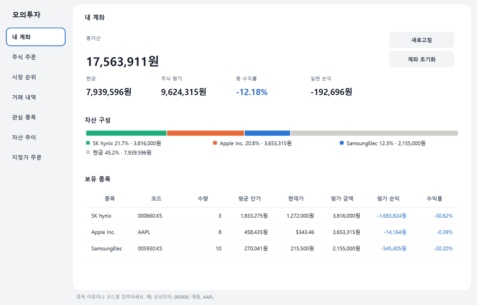
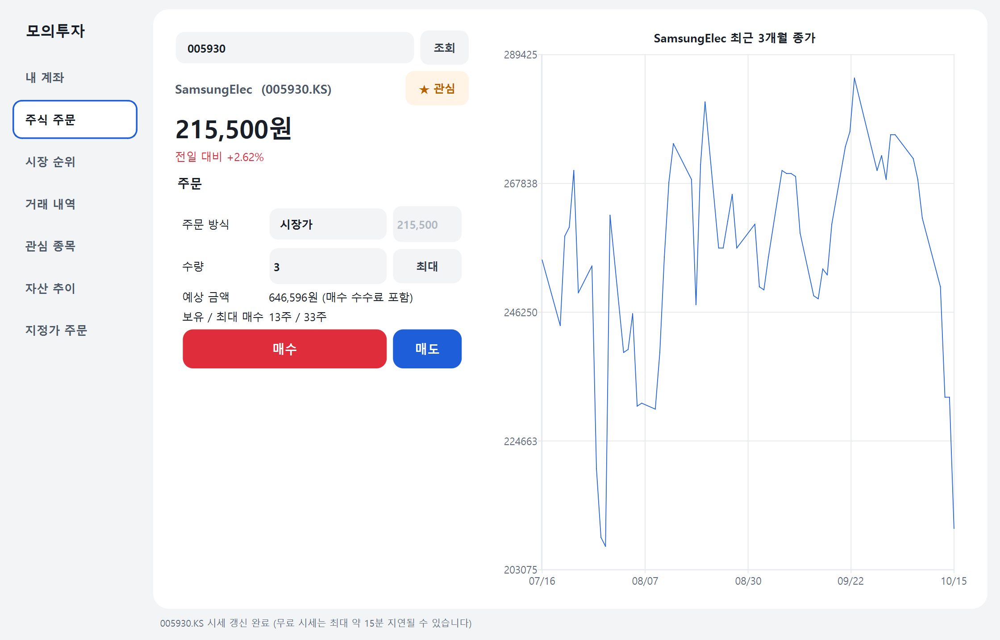
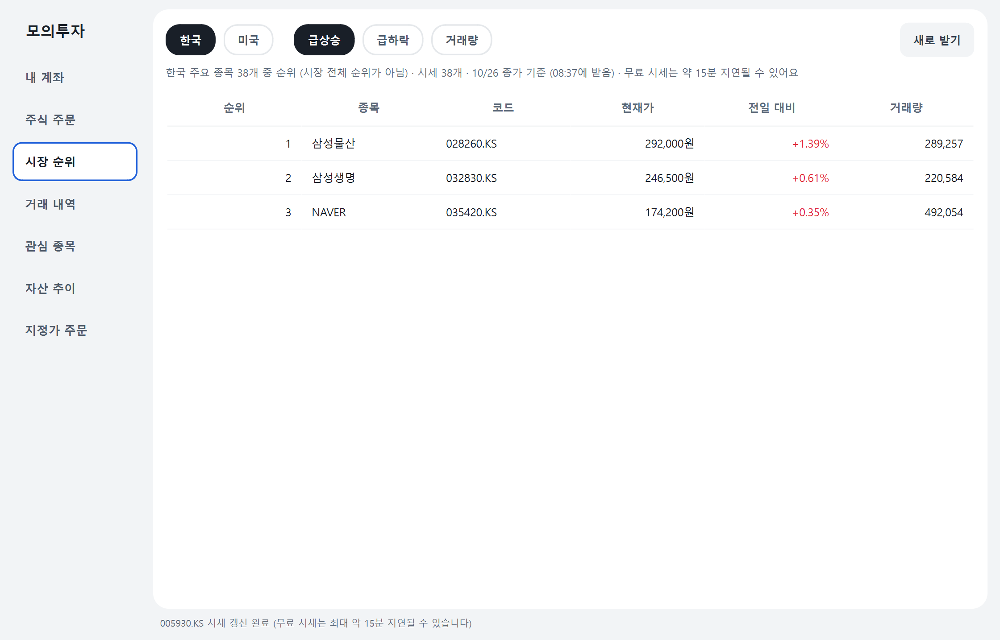
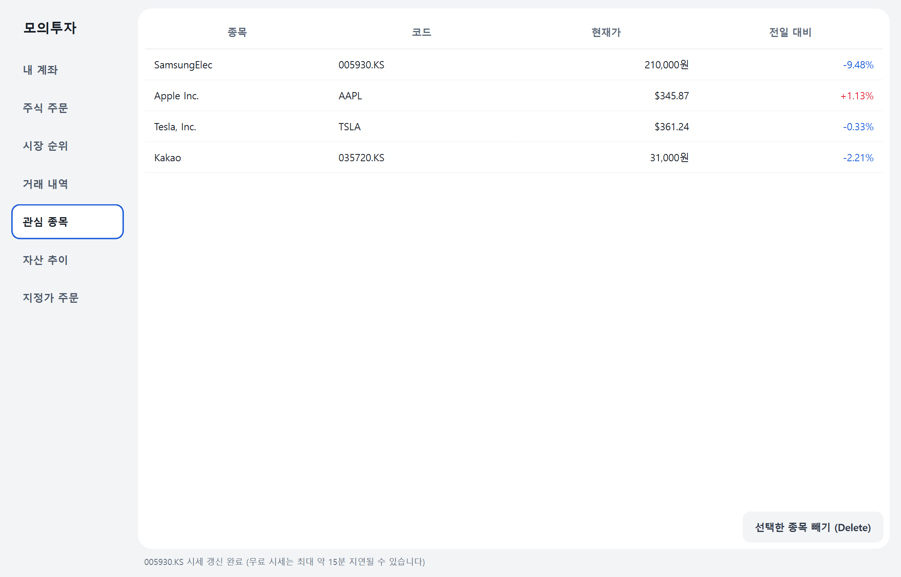
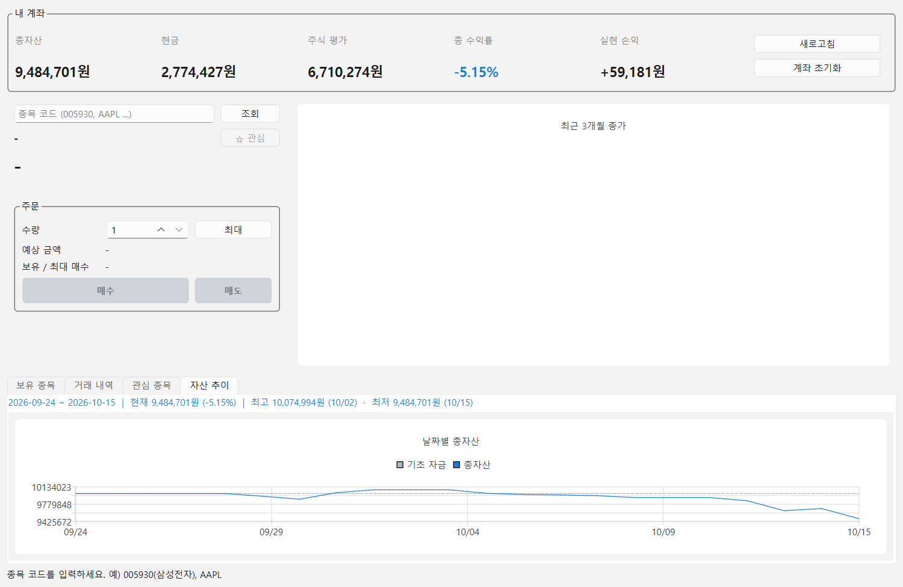
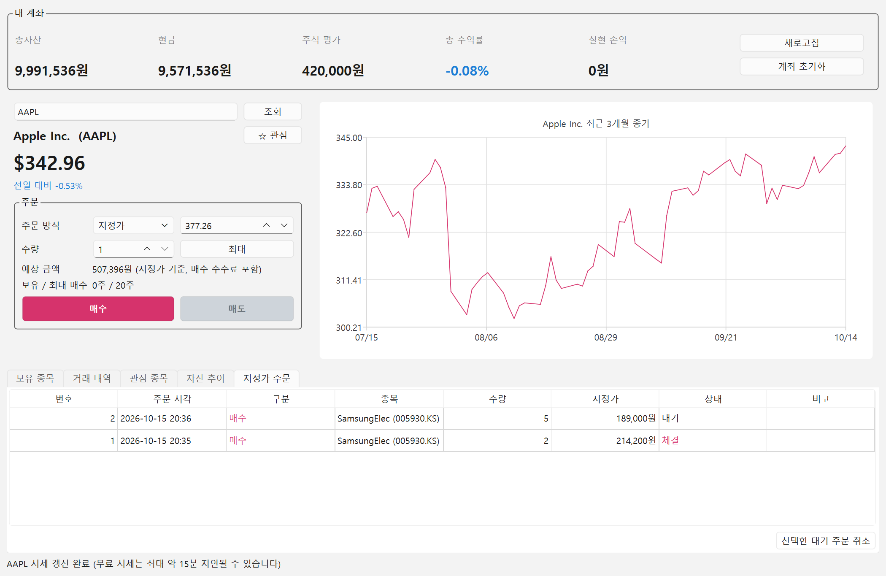
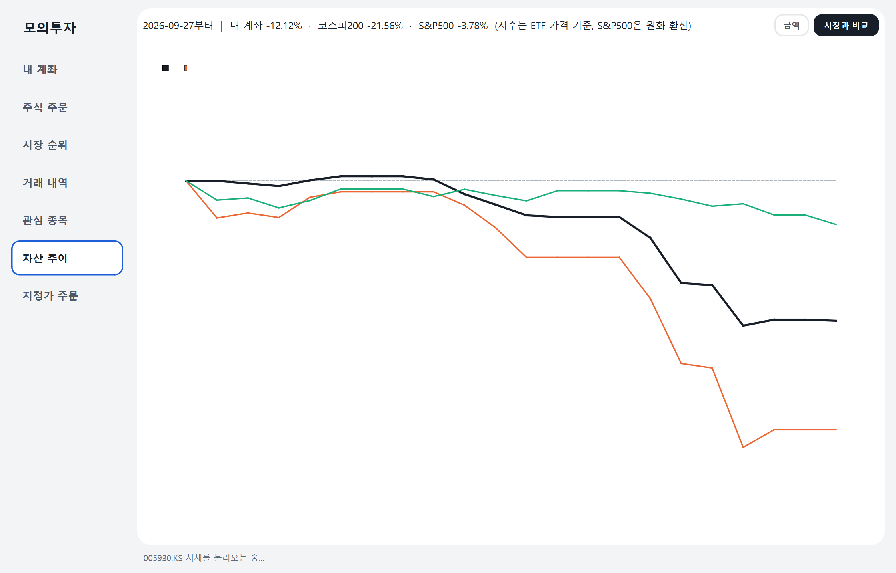
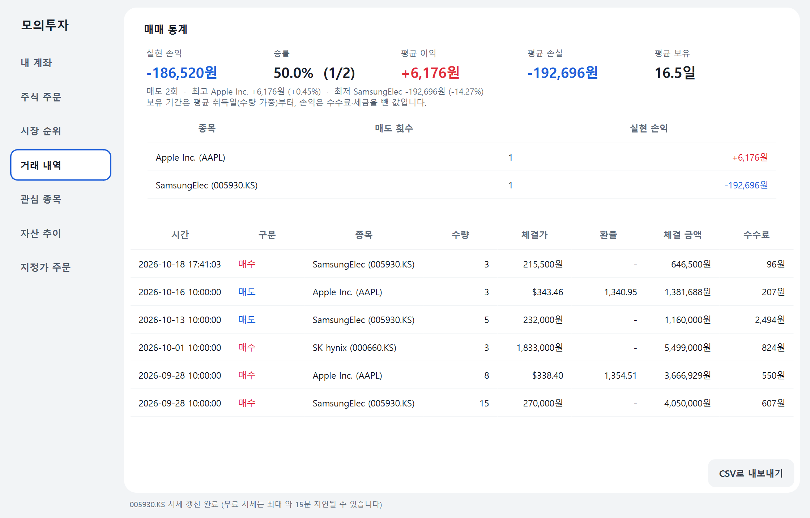
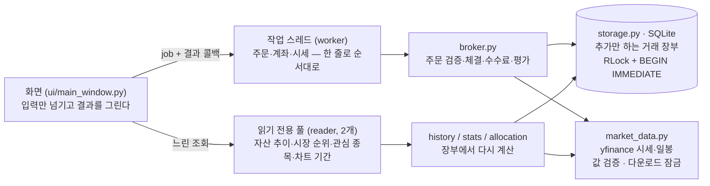

# 모의투자 (Mock Trading)

[](https://github.com/Yongb15/Mock-trading/actions/workflows/tests.yml)

실제 주식 시세(한국 · 미국)를 받아 와서, **가상의 기초 자금**으로 실제처럼 매수·매도를 연습하는 데스크톱 프로그램입니다.

**한눈에 보기**
- Python 3.11+ · PySide6(Qt) · SQLite · yfinance, Windows 실행 파일(zip + SHA-256) 배포 — [Releases](https://github.com/Yongb15/Mock-trading/releases)
- 돈 계산은 전부 `Decimal`, 잔고는 저장하지 않고 **추가만 하는 거래 장부**에서 계산
- 테스트 290여 개(화면·동시성·보안 회귀 포함), PR마다 GitHub Actions(Windows, Python 3.11·3.14)
- 모든 PR은 **QA 세션·보안 세션 두 리뷰어의 승인 + CI 통과** 후에만 병합(브랜치 보호). 리뷰에서 잡힌 문제는 고치기 전 코드에서 실패하는 회귀 테스트와 함께 반영
- 공급망: 간접 의존성까지 버전·해시 고정(`--require-hashes`), 빌드 전 lock 대조, GitHub 액션은 커밋 해시로 고정



| 내 계좌 | 주식 주문 | 시장 순위 |
|---|---|---|
|  |  |  |

| 관심 종목 | 자산 추이 | 지정가 주문 |
|---|---|---|
|  |  |  |

| 시장과 비교 | 매매 통계 |
|---|---|
|  |  |

화면과 시연 GIF는 실제 시세와 임시 연습 계좌로 찍었습니다(`pip install --require-hashes --only-binary :all: -r requirements-build.lock` → `python packaging/make_media.py`, 실제 계좌 DB는 건드리지 않음).

## 주요 기능

깔끔한 핀테크 앱 느낌(연한 회색 바탕, 흰 둥근 카드, 큰 숫자, 상승 빨강·하락 파랑)으로 꾸몄습니다. 왼쪽 메뉴로 내 계좌 · 주식 주문 · 시장 순위 · 거래 내역 · 관심 종목 · 자산 추이 · 지정가 주문 화면을 오갑니다. 모양은 `mock_trading/ui/theme.py` 한 곳에 모여 있습니다.

- **기초 자금 받기**: 처음 실행하면 연습에 쓸 가상 자금(원)을 정합니다. 언제든 초기화하고 다시 시작할 수 있습니다.
- **실제 시세 조회**: 종목 이름(`삼성전자`, 초성 `ㅅㅅㅈㅈ`, 미국 종목은 `애플`처럼 한글로도)이나 코드(한국 6자리 `005930`, 미국 티커 `AAPL`)로 조회합니다. 이름 자동 완성은 시장 순위의 대형주 목록 안에서 찾고, 그 밖의 종목은 코드로 조회합니다. 코스피/코스닥은 자동으로 구분합니다.
- **매수·매도**: 현재가로 체결됩니다. 수수료(0.015%)와 국내 주식 매도 거래세(0.20% 가정)를 반영합니다.
- **미국 주식 환율 적용**: 원화 계좌에서 미국 주식을 사고팔 때 그 시점의 원/달러 환율로 환산합니다. 환차손익도 손익에 들어갑니다.
- **계좌 현황**: 총자산, 현금, 주식 평가액, 총 수익률, 실현 손익을 보여줍니다.
- **자산 구성**: 총자산을 종목별 평가 금액과 현금으로 나눈 비중을 한 줄 막대와 범례(이름·비중·금액)로 보여 줍니다. 상위 5종목 밖은 "기타"로 묶고, 종목 색은 값이 바뀌어도 그대로입니다.
- **보유 종목 · 거래 내역**: 이동평균 매입가와 평가 손익, 전체 체결 기록을 보여줍니다. 거래 내역은 엑셀에서 바로 열리는 CSV로 내보낼 수 있습니다(수식 주입 방지 처리).
- **매매 통계**: 거래 내역 화면에서 실현 손익, 승률, 평균 이익·손실, 평균 보유 기간, 최고·최저 거래, 종목별 실현 손익을 봅니다. 매도 한 건 한 건을 장부와 같은 이동평균 규칙으로 계산해서 합이 계좌의 실현 손익과 정확히 같습니다.
- **매매 일지**: 주문할 때 "왜 샀는지/팔았는지" 메모를 남기고(시장가 체결에 저장), 거래 내역에서 메모를 보고 행을 더블클릭해 고칩니다. 지정가는 체결 뒤 거래 내역에서 남깁니다. 메모는 CSV에도 들어가며, 거래 장부는 고치지 않고 따로 저장합니다.
- **3개월 종가 차트**: 조회한 종목의 최근 흐름을 보여줍니다.
- **시장 순위**: 한국·미국 주요 대형주(한국 38개, 미국 32개) 안에서 오늘 급상승·급하락·거래량 순위를 봅니다. 무료 시세로는 시장 전체 순위를 받을 수 없어 목록 안의 순위이며, 화면에도 그렇게 표시합니다. 5분에 한 번만 새로 받습니다.
- **관심 종목**: 종목명 옆 ☆로 담아 두고, "관심 종목" 탭에서 현재가와 전일 대비를 한 번에 봅니다(최대 50개, 계좌를 초기화해도 남음).
- **지정가 주문**: "이 가격 이하가 되면 사기 / 이상이 되면 팔기"를 걸어 두면, 1분마다 시세를 확인해 **1분 간격으로 두 번 연속** 조건이 맞을 때 **지정가로** 체결합니다. 취소할 때까지 유지되고, 체결·거부는 알림 창과 탭 제목의 건수로 알려 줍니다.
- **자산 추이**: 계좌를 연 날부터 오늘까지 날짜별 총자산을 그래프로 봅니다. 앱을 안 켠 날도 거래 장부와 과거 종가로 다시 계산해 빈칸이 없습니다. **시장과 비교** 보기에서는 계좌를 연 날을 0%로 내 계좌와 코스피200·S&P500의 수익률을 함께 봅니다(지수를 따라가는 ETF 가격 기준, S&P500은 원화 환산, 배당 제외).
- 60초마다 자동으로 갱신합니다.

## 실행 파일로 받기 (Windows)

1. **공식 [Releases](https://github.com/Yongb15/Mock-trading/releases) 페이지에서만** `MockTrading-windows.zip`과 `MockTrading-windows.zip.sha256`을 받습니다.
2. 받은 파일이 올린 파일과 같은지 확인합니다. PowerShell에서 `Get-FileHash MockTrading-windows.zip -Algorithm SHA256` 결과가 `.sha256` 파일의 값과 같아야 합니다.
3. 다운로드 폴더 바로 아래가 아니라 **전용 폴더**(예: `C:\Apps\MockTrading`)에 압축을 풀고 `MockTrading.exe`를 실행합니다.
4. 서명하지 않은 실행 파일이라 처음 실행할 때 "Windows의 PC 보호" 창이 뜰 수 있습니다. 위 확인을 마친 이 파일에 한해 **추가 정보 → 실행**을 누르면 됩니다. SmartScreen이나 백신을 끌 필요는 없고, 끄지 마세요.
5. 걱정되면 실행 파일 대신 아래 "실행 방법"처럼 소스에서 직접 실행할 수 있습니다.

직접 만들기: 새 가상환경에서 `pip install --require-hashes --only-binary :all: -r requirements-build.lock` → `python packaging/build.py`(설치된 버전이 lock과 다르면 빌드가 멈춤)
(결과: `dist/MockTrading/`, 배포용 `dist/MockTrading-windows.zip`과 `.sha256`). 릴리스용은 새 가상환경에서 만드는 것을 권장합니다.
묶인 결과는 `MockTrading.exe --self-check report.txt`로 확인할 수 있습니다(화면 없이 DB·화면 구성·시세를 한 번씩 써 보고 결과를 파일에 씀).

## 실행 방법

Python 3.11 이상이 필요합니다.

```bash
python -m venv .venv
.venv\Scripts\activate          # macOS/Linux: source .venv/bin/activate
pip install --require-hashes --only-binary :all: -r requirements.lock   # 간접 의존성까지 버전·해시 고정(Windows)
#   Python 3.11이면 requirements-py311.lock, Windows가 아니면: pip install -r requirements.txt
python -m mock_trading
```

거래 기록은 `~/.mock_trading/mock_trading.db`(SQLite)에 저장됩니다. 다른 위치를 쓰려면 환경 변수 `MOCK_TRADING_DB`에 파일의 **절대 경로**를 지정합니다(네트워크 드라이브는 SQLite 잠금 문제로 권장하지 않음).

## 테스트

```bash
python -m pytest
```

시세는 가짜 provider로 대신하므로 네트워크 없이 돌아갑니다. PR과 `develop`·`main`에 올라올 때마다 GitHub Actions가 Windows에서 Python 3.11·3.14로 같은 테스트를 돌립니다.

의존성: 사람이 고치는 파일은 `requirements.txt`(앱)·`requirements-build.txt`(빌드 도구)이고, 설치는 간접 의존성까지 정확한 버전과 SHA-256으로 고정한 `*.lock`으로 합니다(`--require-hashes`라 받은 파일이 다르면 설치가 멈추고, `--only-binary :all:`이라 소스를 빌드하지 않음). lock은 Windows 기준입니다. 직접 의존성을 바꾸면 `python packaging/lock.py`(uv 필요)로 lock을 다시 만듭니다.

## 아키텍처



- 화면은 계산하지 않는다 → 핵심 로직을 화면 없이 테스트할 수 있다.
- 순서가 중요한 일(주문·계좌)은 작업 스레드 하나에서 차례로, 느린 조회는 읽기 전용 풀에서 → 조회가 주문을 막지 않는다.
- 비동기 결과는 **무엇에 대한 답인지(종목·기간·계좌 세대)를 함께 들고 와서**, 그사이 화면이 바뀌었으면 버린다.

## 구조

```
mock_trading/
├── domain.py        # 금액 규칙(Decimal), 시세·거래·보유 모델
├── market_data.py   # 시세 조회 인터페이스 + yfinance 구현
├── storage.py       # SQLite 거래 장부, 장부에서 현금·보유·실현손익 계산
├── watchlist.py     # 관심 종목
├── market_rank.py   # 시장 순위(주요 종목 목록 + 순위 계산, 5분 캐시)
├── symbols.py       # 종목 이름 검색(이름·초성·한글 별칭 → 코드)
├── allocation.py    # 자산 구성 비중(상위 종목·기타·현금)
├── stats.py         # 매매 통계(매도별 실현 손익·승률·보유 기간)
├── history.py       # 자산 추이(장부 + 과거 종가로 날짜별 총자산 재계산, 종가 캐시)
├── broker.py        # 주문 검증과 체결, 수수료, 계좌 평가
├── export.py        # 거래 내역 CSV 내보내기(수식 실행 방지)
├── app.py           # 앱 시작, 실행 파일 자가 점검(--self-check)
├── __main__.py      # 실행 진입점
└── ui/
    ├── main_window.py  # PySide6 화면
    ├── allocation_bar.py # 자산 구성 막대·범례
    ├── theme.py        # 색·글꼴·스타일시트, 앱 아이콘(코드로 그림)
    ├── worker.py       # 백그라운드 작업 스레드(주문용 1개 + 읽기용 풀)
    └── format.py       # 금액·수익률 표시 형식
tests/               # pytest
packaging/           # 실행 파일 빌드(build.py), lock 만들기(lock.py), README 화면·GIF(make_media.py)
```

화면(`ui/`)은 입력을 넘기기만 하고, 검증과 계산은 모두 `broker.py`에서 합니다. 그래서 핵심 로직을 화면 없이 테스트할 수 있습니다.

## 설계에서 신경 쓴 점

| 문제 | 결정 |
|---|---|
| float 오차로 잔고가 1원씩 어긋남 | 금액은 전부 `Decimal`. 원화는 1원 단위, 수수료는 버림 |
| 현금과 보유 수량이 서로 어긋날 수 있음 | **추가만 하는 거래 장부**만 저장하고, 현금·보유·실현 손익은 장부에서 계산 |
| 잔고 확인과 기록 사이에 다른 주문이 끼어듦 | 확인과 기록을 한 트랜잭션(`BEGIN IMMEDIATE`)에서 처리 |
| 외부 시세가 NaN·Infinity·0일 수 있음 | 유한한 양수만 받고, 체결 직전 다시 검사, 장부에 기록하기 전에 한 번 더 검사 |
| 달러 가격을 센트로 반올림하면 0원 체결이나 반올림 차익이 생김 | 달러 가격은 0.0001 단위로 시세를 받을 때 한 번만 정규화하고, 체결과 평가에 같은 가격 사용 |
| 데이터 오류로 시세·환율이 튐 | 전일 종가 대비 범위(원화 0.65~1.35배, 달러 1/3~3배)와 환율 범위(500~3000원) 밖이면 주문 차단 |
| 확인창을 본 뒤 가격·환율이 바뀜 | 확인창에서 본 가격·환율과 5% 넘게 다르면 체결 거부 |
| 자동 체결이 잘못된 시세·환율을 그대로 체결 | 50초 이상 간격으로 두 번 연속 확인, 지정가로 체결, 주문 때 확인한 가격·환율과 5% 넘게 다르면 주문 거부, 체결 때 환율이 주문 때와 10% 넘게 다르면 보류 |
| 시세를 기다리는 사이 계좌 초기화 | 계좌 세대 값을 주문 시작과 기록 직전에 비교해 다르면 취소 |
| 외부 종목명에 HTML이 섞일 수 있음 | 제어문자 제거, 길이 제한, 화면에는 일반 텍스트로만 표시 |
| 네트워크 호출로 화면이 멈춤 | 작업 스레드 하나에서 실행하고, Repository의 RLock으로 DB 접근을 직렬화 |
| SQL 인젝션 | 모든 쿼리에 파라미터 바인딩 |
| 늦게 도착한 비동기 결과가 새 화면을 덮어씀(예: 3개월 차트가 5년 차트 위에) | 결과가 "어느 종목·기간·계좌 세대의 답인지" 들고 와서, 지금 상태와 다르면 버림 |
| 공개 메서드에 잠금이 빠지는 회귀(메서드를 끼워 넣다 데코레이터가 밀림) | SQLite 연결을 쓰는 공개 메서드는 모두 잠금인지 **검사하는 테스트**, 트랜잭션 중 다른 스레드가 기다리는지 경합 테스트 |
| 외부·사용자 문자열이 Qt에서 HTML로 해석됨(라벨·툴팁·차트 제목) | 평문 라벨 고정, 툴팁·차트 제목은 이스케이프, 외부 종목명은 창 제목 같은 평문 자리에만 |
| CSV를 엑셀에서 열면 `=`로 시작하는 칸이 수식으로 실행됨 | 글자 칸(종목명·메모)은 공백·보이지 않는 문자를 건너뛰고 판단해 `'`를 붙임 |
| 받은 패키지가 바꿔치기됨 | lock의 SHA-256과 다르면 설치 중단, 소스 빌드 금지(`--only-binary`), 빌드 전 설치 버전을 lock과 대조, 릴리스 zip의 SHA-256을 본문에 기재 |

## 한계

- yfinance 무료 시세는 **최대 약 15분 지연**될 수 있습니다. 실시간 체결과 다릅니다.
- 장 운영 시간과 호가 단위, 상·하한가는 고려하지 않고 현재가로 바로 체결합니다.
- 지정가 주문은 실제 거래소와 달리 더 유리한 가격이 아니라 **항상 지정가로** 체결합니다(잘못 들어온 시세 하나로 공짜 이익이 생기지 않게). 그래서 현재가보다 높은 매수 지정가는 지정가로 사게 됩니다. 여러 주문이 함께 조건에 맞으면 먼저 낸 주문부터 처리합니다.
- 지정가 주문은 앱이 켜져 있을 때 60초마다 확인합니다. 앱을 끈 사이 가격이 지정가를 지나갔다가 돌아오면 체결되지 않습니다. 매수 대기 중에도 현금을 묶어 두지 않으므로, 체결 시점에 현금이 부족하면 거부됩니다.
- 수수료와 세금은 단순화한 값입니다. ETF 거래세 면제, 해외 주식 양도세 등은 반영하지 않습니다.
- 지원 통화는 원(KRW)과 달러(USD)입니다.
- 현재가와 전일 종가를 같은 출처(yfinance)에서 받으므로, 두 값이 함께 잘못 오면 이상 시세 검사를 통과할 수 있습니다.
- 전일 종가를 받지 못하면 시세가 정상인지 판단할 수 없어 매수·매도를 모두 막습니다.
- "시장과 비교"의 지수는 지수를 따라가는 ETF(KODEX 200, SPY)의 가격 수익률이라 배당이 빠져 있고, 실제 지수와 조금 다를 수 있습니다.
- 종목 이름 검색은 시장 순위에 쓰는 대형주 70종목 안에서만 됩니다. 그 밖의 종목은 코드로 조회합니다.

## 브랜치 전략과 릴리스

- `main`: 릴리스된 안정 버전(태그 `vX.Y.Z`), `develop`: 통합 브랜치, `feature/*`: 기능별 작업
- `main`·`develop`은 브랜치 보호: CI(`pytest (3.11)`, `pytest (3.14)`) 통과 없이는 병합 불가, 강제 푸시·삭제 금지
- 릴리스: 버전 PR(리뷰) → `develop`→`main` PR(CI) → 태그 → `pip check` + 빌드 lock 대조 → 실행 파일 빌드 → 자가 점검(`--self-check`) → zip·SHA-256 업로드, 다시 내려받아 해시 확인 → 보안 세션의 사후 확인(태그 ↔ 승인 코드, zip 목록 검사)

## 개발 방식

세 개의 Claude Code 세션으로 역할을 나눠 개발했습니다.

- **Code**: 기능 구현, 리뷰 반영(코드를 고치는 유일한 세션)
- **QA**: 버그·테스트 누락·화면 확인(코드를 직접 고치지 않고 `파일:줄 + 원인 + 수정안`으로 회신)
- **Security**: 보안 리뷰(입력·표시·외부 요청·공급망, 마찬가지로 직접 고치지 않음)

규칙: 두 리뷰어가 **같은 커밋 해시**를 승인해야 병합하고, 승인 뒤 커밋이 하나라도 추가되면 새 해시로 다시 승인받습니다.

리뷰가 잡은 문제 예시
- 외부 시세의 `NaN` 하나가 장부를 영구히 망가뜨릴 수 있음 → 받을 때·체결 직전·기록 직전 세 겹 검사 (v0.1.0)
- 자동 체결(지정가)이 잘못 들어온 시세 한 번으로 이익을 만듦 → 두 번 연속 확인 + 지정가 체결 + 환율 이중 검사 (#6)
- 차트 기간을 바꾸는 사이 도착한 옛 결과가 새 차트를 덮어씀 → 결과에 기간을 담아 비교 (#27)
- 보기 전환마다 이전 차트가 해제되지 않아 메모리가 쌓임 → 교체한 차트 삭제 + 해제 확인 테스트 (#34)
- 메서드를 끼워 넣다 잠금이 빠져 롤백될 거래를 다른 스레드가 읽을 수 있음 → 잠금 복원 + 잠금 검사·경합 테스트 (#39)
- CI 설정의 `:all: `이 YAML 키로 읽혀 워크플로가 통째로 깨짐, 작업 이름이 바뀌면 필수 검사가 영원히 대기 → 따옴표·`name:` 명시 (#31)
